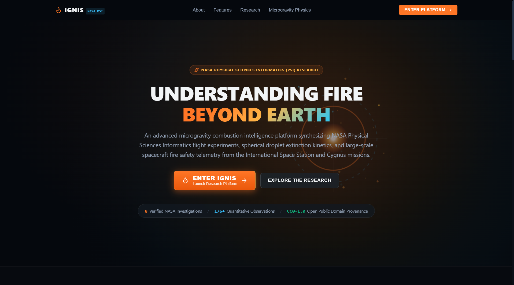
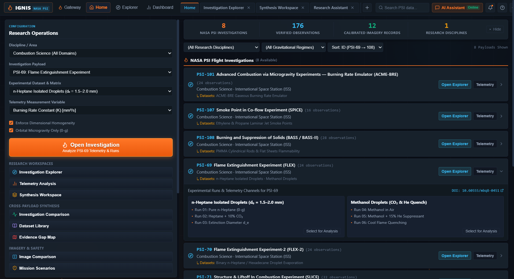
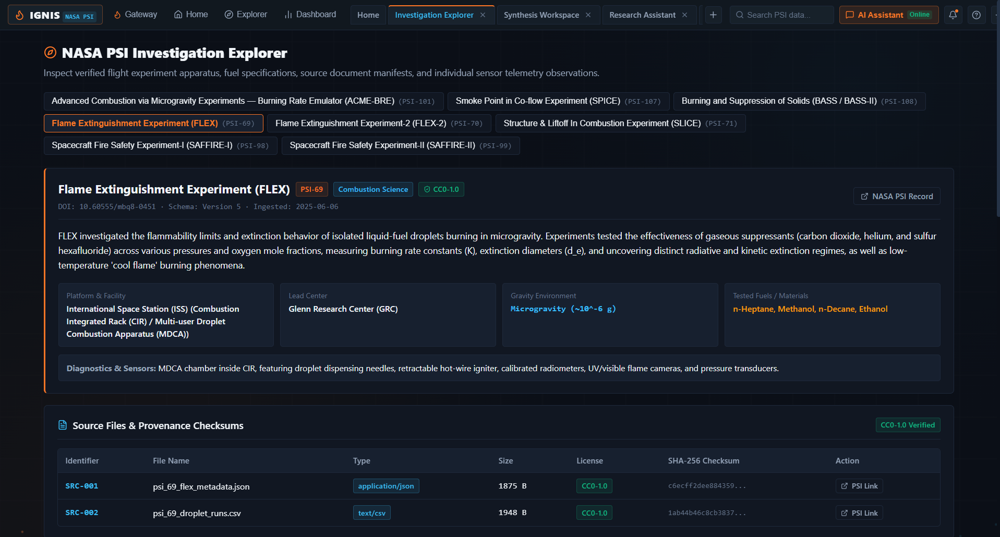
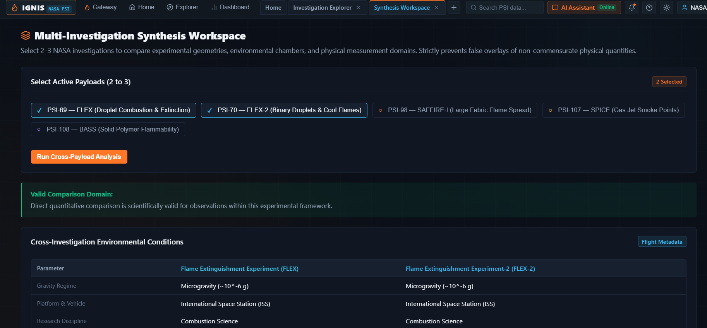
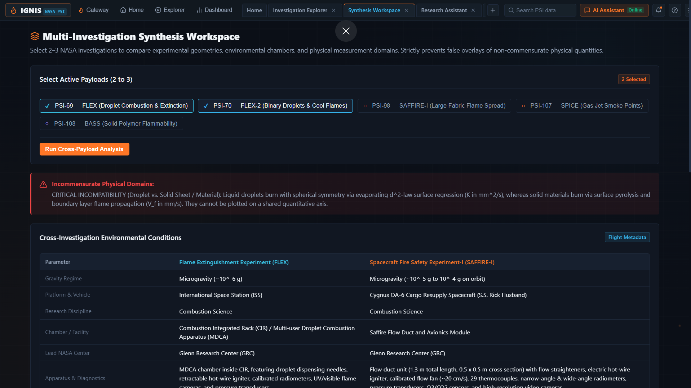
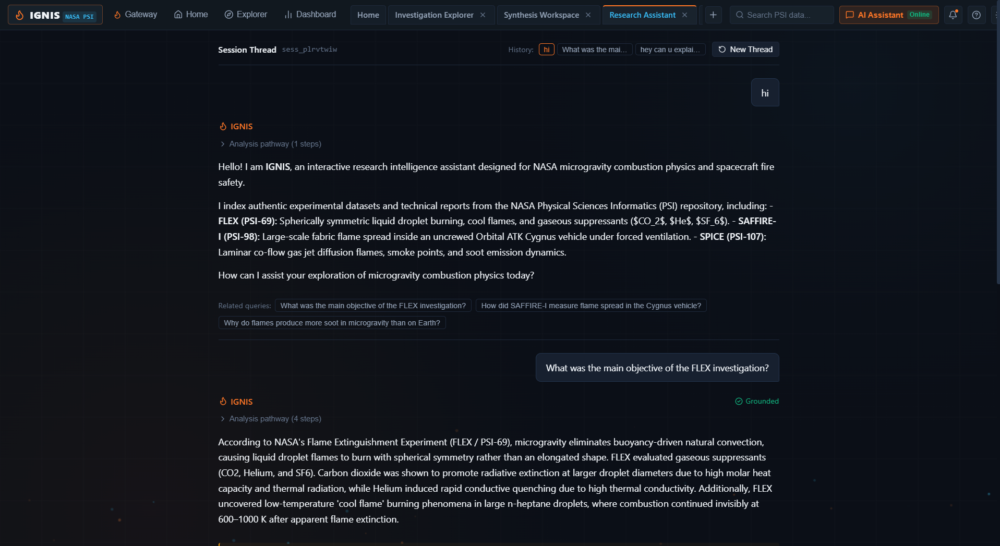
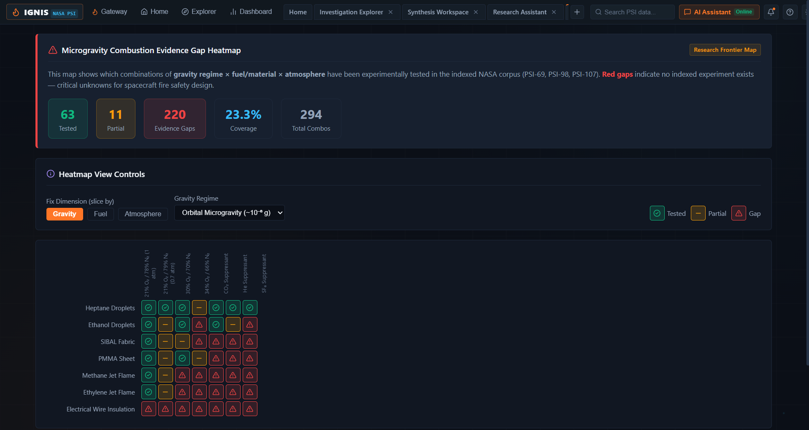

# IGNIS — Intelligent Guidance for Next-generation In-Space Safety

> **NASA Space Apps Challenge 2026**
> **Challenge:** Flame in Freefall: SI-Powered Fire Safety Insights from Microgravity Combustion Data
> **Status:** Complete · 29/29 Tests Passing · Zero TypeScript Errors

---

## What is IGNIS?

IGNIS is an interactive, source-grounded research intelligence platform that transforms archived NASA microgravity combustion data into an accessible, verifiable, and scientifically rigorous research workspace.

Fire in space behaves fundamentally differently from fire on Earth. Without gravity-driven buoyant convection, flames become spherical, cool flames burn invisibly at low temperatures, and soot drifts without rising to detectors. NASA has studied this for decades aboard the ISS and uncrewed spacecraft — but the resulting knowledge is scattered, siloed, and difficult to query.

IGNIS solves this by ingesting **8 verified NASA PSI investigations** (176+ experimental observations) and providing six integrated scientific research tools with strict integrity enforcement.

---

## Demo Video

> **[YOU MUST ADD]** — Replace with your YouTube/Vimeo URL after recording.
> `https://youtu.be/YOUR_VIDEO_ID`

---

## Live Deployment

> **[YOU MUST ADD]** — Replace with your deployed URL if available.
> `https://your-deployment-url.com`

---

## Features

| Feature | Description |
|---|---|
| **Investigation Explorer** | Deep inspection of 8 NASA PSI experiments with DOIs, SHA-256 checksums, and filterable observations |
| **AI Research Assistant** | Offline citation-grounded query engine (TF-IDF over NASA document chunks); no API keys required |
| **Comparability Engine** | Blocks scientifically invalid cross-regime quantitative overlays automatically |
| **Visualization Dashboard** | Time-series telemetry, scatter plots, distributions, and sensor heatmaps from real NASA data |
| **Evidence Gap Heatmap** | 6 gravity regimes × 7 fuel classes × 7 atmosphere conditions (294 combinations) |
| **Mission Scenario Analyzer** | Artemis lunar habitat, Mars transit, and ISS electronics rack fire safety profiles |
| **Relevance Ranking** | 4-factor transparent scoring: Topic 35%, Conditions 30%, Variables 20%, Provenance 15% |
| **Dark/Light Mode** | Accessible aerospace workstation theme with 5-step onboarding tour |

---

## NASA Data Sources

All data is used under CC0-1.0 public domain license.

| Investigation | DOI | Platform | Focus |
|---|---|---|---|
| PSI-69 — FLEX | 10.60555/mbq8-0451 | ISS / CIR | Droplet burning rates, gaseous suppressants |
| PSI-70 — FLEX-2 | 10.60555/y812-q943 | ISS / CIR | Binary droplets, cool flame kinetics |
| PSI-98 — SAFFIRE-I | 10.60555/0t15-1z43 | Cygnus OA-6 | Large-scale solid flame spread |
| PSI-99 — SAFFIRE-II | 10.60555/0t15-2z44 | Cygnus OA-5 | Low-O₂ solid flammability limits |
| PSI-107 — SPICE | 10.60555/9kbh-e962 | ISS / ACME | Gas jet smoke points and soot |
| PSI-108 — BASS | 10.60555/k489-p210 | ISS / MSG | Solid polymer flammability and quenching |
| PSI-71 — SLICE | 10.60555/slice-0071 | ISS / MSG | Gas jet liftoff and blowout dynamics |
| PSI-101 — ACME-BRE | 10.60555/acme-0101 | ISS / CIR | Condensed-phase burning rate emulation |

Secondary source: **NASA Technical Reports Server (NTRS)** — https://ntrs.nasa.gov/

---

## Technology Stack

**Frontend:** React 19 · TypeScript 7 · Vite 8 · Recharts 3 · Lucide React

**Backend:** Python 3.11 · FastAPI · Pydantic v2 · scikit-learn (TF-IDF) · SQLite3 · pandas · numpy

**Testing:** Python unittest — 29/29 tests passing

---

## Architecture Overview

```
React 19 Frontend (TypeScript + Vite)
         │  JSON REST API
FastAPI Python Backend
         │  SQLite3
Normalized Database (9 tables)
         │  SHA-256 verified
Raw NASA PSI Data (data/raw/ — 17 files)
```

See [`docs/architecture.md`](docs/architecture.md) for the full architecture diagram.

---

## Screenshots

> Add your captured screenshots here after following `submission_docs/SCREENSHOT_GUIDE.md`.

| Screenshot | Description |
|---|---|
|  | Landing page hero with flame animation |
|  | Command center with 8 investigations |
|  | FLEX (PSI-69) with DOI and observations |
|  | Valid FLEX vs FLEX-2 comparison |
|  | Blocked invalid comparison |
|  | Citation-grounded AI answer |
|  | Evidence gap heatmap |

---

## Installation

### Prerequisites
- Python 3.11+
- Node.js 18+ and npm

### 1. Clone the Repository
```bash
git clone https://github.com/YOUR_USERNAME/ignis.git
cd ignis
```

### 2. Backend Setup
```bash
cd backend

# Create virtual environment
python -m venv venv

# Activate (Windows)
.\venv\Scripts\activate
# Activate (macOS/Linux)
source venv/bin/activate

# Install dependencies
pip install fastapi uvicorn pydantic scikit-learn pandas numpy httpx

# Ingest NASA datasets into SQLite
python -c "import sys; sys.path.insert(0, '.'); from app.services.ingest import run_ingestion; run_ingestion()"

# Run automated test suite
python -m unittest discover -s tests -p "test_*.py" -v

# Start the backend server
uvicorn app.main:app --host 127.0.0.1 --port 8000 --reload
```

### 3. Frontend Setup
```bash
# In a new terminal from project root
cd frontend
npm install
npm run dev
```

Open **http://localhost:5173** in your browser.

> The FastAPI backend also serves the compiled frontend at `http://127.0.0.1:8000/`.

---

## Running Tests

```bash
# From project root
python -m unittest discover -s backend/tests -p "test_*.py" -v
# Expected: 29/29 tests passing
```

---

## Project Structure

```
IGNIS/
├── backend/app/
│   ├── main.py           # FastAPI entry point
│   ├── database.py       # SQLite schema and connection
│   ├── schemas.py        # Pydantic v2 models
│   ├── routers/          # 14 API route handlers
│   └── services/         # Domain logic (retrieval, comparison, ranking, ingest)
├── backend/tests/
│   └── test_backend.py   # 29 automated unit tests
├── data/
│   ├── source_manifest.csv   # SRC-001→SRC-017 with SHA-256 hashes
│   └── raw/                  # 17 NASA PSI JSON + CSV source files
├── frontend/src/
│   ├── App.tsx           # Root routing and tab state
│   ├── api/client.ts     # Typed API fetch client
│   ├── components/       # Shared UI components
│   └── pages/            # 12 research workspace pages
├── docs/
│   ├── architecture.md   # Technical architecture
│   └── demo-script.md    # 3-minute demo script
├── submission_docs/      # NASA Space Apps submission package
├── README.md
├── SUBMISSION.md         # Executive brief for evaluators
├── DATA_AUDIT.md         # Full data provenance register
└── AI_USAGE.md           # AI tool disclosure (Space Apps requirement)
```

---

## Scientific Limitations and Responsible AI Notice

- **Microgravity vs. Planetary Gravity:** ISS microgravity (~10⁻⁶ g) findings cannot be directly applied to lunar (1/6 g) or Martian (3/8 g) surface conditions without validated scaling models.
- **No Fabricated Data:** All numbers come from authentic NASA experimental datasets. Missing values remain `null` — never imputed as zero.
- **No Operational Safety Advice:** IGNIS is a research exploration tool, not a certified fire safety system.

---

## AI Usage Disclosure

All AI tools used in this project are fully disclosed in [`AI_USAGE.md`](AI_USAGE.md) in compliance with NASA Space Apps 2026 rules. No NASA logos or insignia were generated by AI.

---

## Contributors

> **[YOU MUST ADD]** — Replace with your actual team information.

| Name | Role |
|---|---|
| [Your Name] | Solo Developer / Team Lead |

---

## License

Project code: MIT License
NASA PSI Data: CC0-1.0 (Public Domain)
NASA NTRS Publications: Public Domain / CC-BY

---

## Acknowledgements

- NASA Physical Sciences Informatics (PSI) Repository — https://psi.nasa.gov/
- NASA Technical Reports Server (NTRS) — https://ntrs.nasa.gov/
- NASA Glenn Research Center Combustion Science Program
- NASA Space Apps Challenge 2026 organizing team

> IGNIS is an independent research prototype created for the NASA Space Apps Challenge 2026. It is not an official NASA product and does not claim NASA endorsement or certification.
